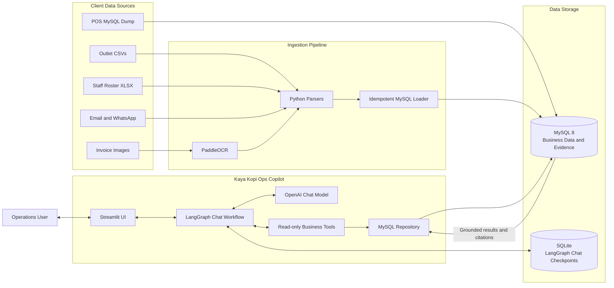

# Kaya Kopi Ops Copilot Architecture

This diagram describes the architecture currently implemented in the project.

MySQL stores operational data and citable evidence. SQLite is used only by LangGraph to persist chat messages and workflow checkpoints by conversation thread. The copilot accesses business data through read-only tools and does not modify client records.
