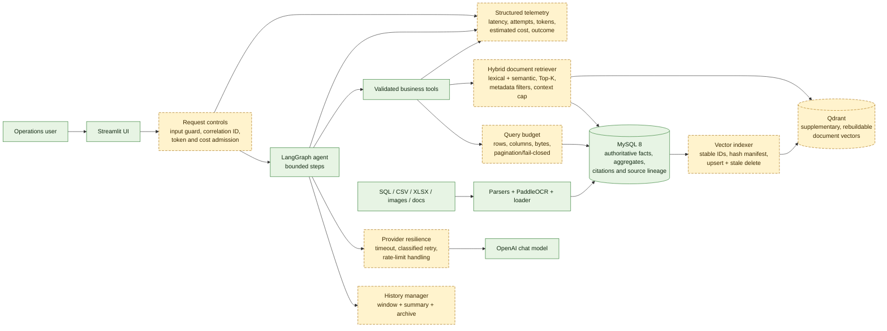

# Kaya Kopi Copilot — AI Agent Enhancement Assessment

Assessment date: 2026-11-21
Basis: static, read-only inspection of the repository, plus the developer-confirmed USD 50 budget on the provided LLM API key. No services were started and no paid LLM or embedding calls were made.

## First recommendation

Do not re-platform the application. Keep the current Streamlit + LangGraph + MySQL architecture and first add a bounded agent runtime: enforce per-turn and per-thread token budgets, compact old history, cap tool-loop steps, bound every tool result by rows/columns/serialized bytes, and record usage/latency/outcomes. These P0 controls address the highest demo and cost risks without changing the proven business-query layer. Add provider resilience next. Add Qdrant only as a rebuildable, supplementary semantic index for unstructured document chunks; MySQL must remain authoritative for financial facts, source lineage, filters, and aggregations.

## Assessment method and classifications

- **Implemented**: production path exists and has repository evidence.
- **Partial**: some relevant mechanism exists, but it does not meet the requested operational property end to end.
- **Missing**: no implementation or configuration was found in the tracked repository.
- **Unable to determine**: the repository cannot establish the fact (for example, deployed infrastructure or provider-account settings).

Path and line references below are relative to the repository root and refer to the inspected revision.

## A. Current architecture — actual implementation

### A1. Runtime entry points, framework, and request path

The application is a Python 3.12 Streamlit service. Its container starts `python -m streamlit run app/streamlit_app.py` (`app/Dockerfile:1-10`). Streamlit collects a prompt, streams the agent response, displays tool activity, and converts an uncaught turn failure into a generic user-facing error (`app/streamlit_app.py:101-145`). A browser session owns a UUID thread and can reopen checkpointed threads (`app/streamlit_app.py:25-37`, `app/streamlit_app.py:51-80`).

The backend is a small LangGraph state machine:

1. `ChatState` contains only an append-only `messages` list (`app/chat_backend.py:42-43`).
2. The chat node prepends a system prompt and invokes a tool-bound model (`app/chat_backend.py:69-73`).
3. `tools_condition` routes model tool calls to `ToolNode`; tool results loop back to the model until it emits a final answer (`app/chat_backend.py:77-83`).
4. `stream_chat` passes one human message under a caller-provided `thread_id` and streams message events (`app/chat_backend.py:99-108`).

This is a reactive tool-calling agent, not a planner/executor, supervisor, or multi-agent system. No HTTP API boundary, background worker, task queue, or MCP server exists in the application path.

### A2. Model configuration and invocation

The sole model integration is LangChain `ChatOpenAI` (`app/chat_backend.py:11-17`). It defaults to `gpt-4o-mini`, temperature 0, 30-second timeout, and two model-client retries; only the model name is currently configurable through `KAYA_OPENAI_MODEL`, while temperature, timeout, and retry count are hardcoded (`app/chat_backend.py:61-67`). `OPENAI_API_KEY` is correctly required from the environment at graph construction rather than stored in source control (`app/chat_backend.py:52-59`). Invocation is synchronous inside the graph node (`app/chat_backend.py:69-73`), while LangGraph events are streamed to the UI.

Operational model settings should be represented by one validated runtime configuration rather than scattered constants. At minimum, make the model name, request timeout, retry count, maximum output tokens, context/input budget, graph-step limit, and usage/cost thresholds configurable with safe defaults and startup validation. Temperature may remain fixed at 0 for deterministic business analysis, or be configurable only within an approved narrow range if a demonstrated use case requires it. The API key must remain secret environment/configuration input. The system prompt and financial authority/comparability rules should remain version-controlled and reviewed; they should not become freely mutable environment variables. Safety-critical rules must also be enforced in code rather than relying only on prompt text.

The system prompt requires tool-grounded facts, source citations, explicit missing-evidence behavior, scanned-invoice authority, and conservative comparison rules (`app/chat_backend.py:22-39`). These are valuable model instructions, but they are not deterministic input/output guardrails.

### A3. Tools and business-query boundary

Seven tools are exposed to the model: outlet analysis, POS analysis, supplier analysis, coverage, document search, price-change assessment, and quality issues (`app/tools/kaya.py:224-232`; the consolidated set is asserted at `tests/integration/test_query_tools.py:23-28`). Pydantic schemas constrain dates, enum-like analysis modes, collection lengths, search limit, and scenario values (`app/tools/kaya.py:17-99`).

Each tool delegates to a cached `MySQLRepository`. Validation errors and `pymysql.MySQLError` become structured `{ok: false}` results (`app/tools/kaya.py:101-117`). The public tools are read-only and return structured evidence (`app/tools/kaya.py:120-221`).

Important current limits:

- Date range is limited to 3,660 days (`app/repositories/mysql.py:106-110`).
- Outlet collections are limited to 12 and search `limit` to 10 (`app/tools/kaya.py:24-30`, `app/tools/kaya.py:42-46`).
- Document search validates the 1–10 limit and applies SQL `LIMIT` (`app/repositories/mysql.py:978-1020`).
- No universal row, selected-column, serialized-byte, or tool-payload token cap exists. `_query` fetches and serializes the complete result set (`app/repositories/mysql.py:134-138`). Several analytical queries are naturally bounded by grouped dimensions or the twelve outlets, but that is not an enforced cross-tool contract.
- There is no pagination contract or continuation token. This is acceptable for compact aggregates but unsafe as the corpus grows.

### A4. SQL, authority, and retrieval

MySQL 8 is the authoritative operational store. Repository queries are parameterized at execution (`app/repositories/mysql.py:134-138`), and connections have 5-second connect plus 10-second read/write timeouts (`app/repositories/mysql.py:119-132`). Aggregation is generally performed database-side: wastage uses `COUNT`, `SUM`, and `AVG` (`app/repositories/mysql.py:330-343`); POS analyses use `SUM`, `MIN`, `MAX`, `AVG`, and `GROUP BY` (`app/repositories/mysql.py:564-581`); coverage uses count queries (`app/repositories/mysql.py:1057-1089`). This is the correct foundation for financial totals.

The repository explicitly distinguishes authority and comparability. Incomplete POS results carry a warning (`app/repositories/mysql.py:583-590`), unmeasured wastage is not ranked (`app/repositories/mysql.py:363-382`), staffing refuses to invent an overstaffing threshold and excludes non-comparable revenue (`app/repositories/mysql.py:450-469`), and price analysis returns `INSUFFICIENT_EVIDENCE` (`app/repositories/mysql.py:1124-1133`).

Unstructured retrieval is currently MySQL FULLTEXT over `document_chunk`, with entity filters and a substring fallback (`app/repositories/mysql.py:978-1049`). The schema contains source URI/hash/ingestion status, chunk text, an unused `embedding_ref`, and a FULLTEXT index (`ingestion/schema/schema.sql:5-19`, `ingestion/schema/schema.sql:178-208`). There is no vector database, embedding client, semantic retrieval, reranker, or hybrid rank fusion.

Financial totals must continue to be produced by SQL aggregates over authoritative tables. If any future payload limit would truncate contributing rows, the tool must fail closed with a clear `RESULT_LIMIT_EXCEEDED`/`AGGREGATION_REQUIRED` response rather than calculate or present a total from the truncated subset.

### A5. Memory and context behavior

LangGraph checkpoints are persisted through `SqliteSaver` using a process-held SQLite connection (`app/chat_backend.py:46-49`, `app/chat_backend.py:75-83`). The Compose service stores the file on the `copilot_runtime` volume (`docker-compose.yml:38-58`). This supports restart persistence and follow-up context; the UI reloads human and final assistant messages (`app/streamlit_app.py:29-37`).

However, the state reducer appends every message, including tool traffic, and the complete message state is passed to every model invocation (`app/chat_backend.py:42-43`, `app/chat_backend.py:69-73`). There is no message/token window, history summarization, compaction checkpoint, archival boundary, maximum turns, per-turn input/output limit, or maximum graph/tool-loop steps. A long thread or large tool response can therefore exhaust model context or spend unexpectedly.

### A6. Output formatting, limits, errors, retries, and timeouts

Formatting is mostly prompt-driven: concise answers, SGD, citations, limitations, and authority rules (`app/chat_backend.py:22-39`). Structured tool results help, but final-answer schema validation and citation completeness checks are absent.

Existing resilience:

- Model call: 30-second timeout and two retries (`app/chat_backend.py:61-66`).
- MySQL: connect/read/write timeouts (`app/repositories/mysql.py:119-132`).
- Repository wrapper: known validation and MySQL failures become structured errors, but caught database exceptions are not logged (`app/tools/kaya.py:106-117`).
- UI: all other turn failures become a generic response containing the exception type, but the exception and traceback are not logged (`app/streamlit_app.py:110-133`).

Missing resilience includes explicit rate-limit handling, retry classification, jittered exponential backoff under application control, `Retry-After` support, concurrency limits, provider-health state, fallback model policy, and retry/timeout telemetry. A circuit breaker is also absent, but neither the client brief nor the harness requires one; it is KIV unless sustained provider instability or a multi-user deployment demonstrates the need. Retries, rate-limit handling, token budgets, and cost controls solve different problems and should be implemented and measured separately.

### A7. Logging, metrics, token usage, and cost

The UI shows tool name/result only for the active browser session (`app/streamlit_app.py:82-87`, `app/streamlit_app.py:113-125`). `docker compose logs -f copilot` is documented (`README.md:37-43`), but no application logging configuration or structured request/event logger was found. In particular, caught MySQL exceptions and uncaught turn exceptions are converted into user responses without a server-side exception record or traceback (`app/tools/kaya.py:106-117`, `app/streamlit_app.py:129-133`). This makes `docker compose logs` insufficient for troubleshooting. There is no request ID, per-node/tool latency, error classification, retry counter, provider usage metadata capture, input/output/cache token count, estimated cost, cumulative budget, metrics endpoint, tracing backend, or persisted replay record. The repository warns that the API key has a hard budget (`README.md:57-62`), and the developer has confirmed that limit is USD 50, but the application does not track consumption against it. The checklist explicitly expects tool calls, latency, token usage, spend tracking, and replayability (`HARNESS_CHECKLIST.md:44-49`).

### A8. Compose, ingestion/OCR, tests, and CI

Compose defines MySQL, one-shot ingestion, Copilot, and a test container; MySQL and chat use separate named volumes (`docker-compose.yml:1-84`). No Qdrant, metrics collector, dashboard, reverse proxy, or API service is defined.

The rebuild pipeline runs PaddleOCR, invoice parsing, document parsing, tabular parsing, roster parsing, and the MySQL loader in sequence (`scripts/ingest_container.sh:1-15`). OCR normalizes orientation/contrast, records text regions and confidence, and writes sidecars (`ingestion/parsers/invoice_ocr.py:81-147`). The reload process recreates the application database and all normalized data (`ingestion/README.md:19-34`). Loader keys are stable and use upserts, so reloads are idempotent at the MySQL layer (`ingestion/README.md:52-56`). Source records preserve URI, SHA-256, type, extraction status, and ingestion time (`ingestion/schema/schema.sql:5-19`).

`scripts/test.sh` starts MySQL and runs unittest discovery in the test container (`scripts/test.sh:1-9`). Integration coverage verifies authority, exclusions, citations, incomplete evidence, aliases, staffing, wastage, reconciliation, and safe validation failures (`tests/integration/test_query_tools.py:30-157`, `tests/integration/test_query_tools.py:194-409`). The six real-model acceptance prompts are manual and explicitly non-deterministic (`scripts/run_llm_acceptance.py:1-38`, `README.md:45-53`). No tracked CI workflow was found, and the six LLM checks are below the checklist's requested 20-case suite (`HARNESS_CHECKLIST.md:51-56`). Deployed CI status is therefore **unable to determine**; repository CI configuration is **missing**.

## B. Gap analysis

| Area | Classification | Existing evidence | Gap to close |
|---|---|---|---|
| Context exhaustion prevention | **Partial** | Tool schemas constrain some list/search sizes; persistent messages exist (`app/tools/kaya.py:17-99`; `app/chat_backend.py:42-43`). | No token-aware history window, compaction, maximum turns/steps, global tool payload cap, output cap, or explicit context-overflow recovery. |
| SQL DB-side aggregation | **Implemented** for core analyses | Aggregates are computed in SQL (`app/repositories/mysql.py:330-343`, `app/repositories/mysql.py:564-581`). | Make this an invariant and add aggregate-only/paginated contracts so new tools cannot return raw unbounded rows or derive financial totals from truncated data. |
| SQL pagination / row-column-byte caps | **Partial** | Document search has `LIMIT 1..10` (`app/repositories/mysql.py:978-1020`); some domains are inherently small. | No reusable page contract, allowlisted projections, response byte/token budget, truncation marker, or fail-closed total policy. |
| Agent maximum steps | **Missing** | Graph loops model → tools → model (`app/chat_backend.py:77-83`). | Add recursion/tool-call limits and a clear `MAX_AGENT_STEPS` terminal response. |
| Token budget and cost control | **Missing** | Model and key are configurable (`app/chat_backend.py:52-67`); the confirmed key budget is USD 50. | Capture provider usage; enforce input/output/per-thread budgets; maintain cumulative estimated spend; warn and deny at configured thresholds below the provider's USD 50 hard limit. |
| LLM timeout/retry | **Partial** | 30-second timeout, two SDK-level retries (`app/chat_backend.py:61-66`). | Classify transient/permanent failures, respect rate-limit metadata, instrument attempts, use bounded jitter, and avoid retrying validation/context errors. |
| Rate-limit handling | **Missing** | No explicit code found. | Parse 429/`Retry-After`, bound queue/concurrency, return a user-safe retryable error. |
| Circuit breaker | **Missing / KIV** | No explicit code found, and neither the client brief nor harness requires it. | Defer for the capstone. Reassess only if telemetry shows repeated provider failures where bounded retries cause avoidable load or poor recovery. |
| Exception logging | **Missing** | Database exceptions are swallowed into structured tool errors, and the UI catches other exceptions without logging (`app/tools/kaya.py:106-117`; `app/streamlit_app.py:129-133`). | Log each operational exception once with traceback, request/thread ID, failing layer/operation, and safe context; return a sanitized user message containing the request ID. |
| LLM monitoring | **Missing** | Ephemeral sidebar tool log only (`app/streamlit_app.py:82-87`). | Structured events for request, model, tool, retry, outcome, latency, usage, estimated cost, and correlation IDs; redact sensitive content. |
| Trace replay | **Missing** | SQLite stores conversation state, not a purpose-built immutable trace (`app/chat_backend.py:75-96`). | Persist bounded/redacted trace metadata and tool inputs/results or hashes sufficient for deterministic tool replay. |
| Qdrant semantic retrieval | **Missing** | MySQL FULLTEXT plus substring fallback (`app/repositories/mysql.py:978-1049`); `embedding_ref` is unused (`ingestion/schema/schema.sql:178-193`). | Add rebuildable vector index, embedding/index manifests, stable point IDs, sync/reindex/delete lifecycle, metadata filters, hybrid retrieval, Top-K/context caps, and tests. |
| Grounded SQL + semantic routing | **Partial** | The agent has SQL business tools and lexical document search (`app/tools/kaya.py:120-221`). | Define routing/fusion: SQL for measures/filters/authority; Qdrant for discovery; fetch canonical text/citations from MySQL; never let vector payloads become the financial source of truth. |

## C. Evidence-backed risks and technical debt

| Risk/debt | Evidence | Impact | Priority |
|---|---|---|---|
| Unbounded checkpointed history and tool payloads | Append-only messages and full-state model invocation (`app/chat_backend.py:42-43`, `app/chat_backend.py:69-73`) | Context overflow, increasing latency/cost, failed long conversations | P0 |
| Unlimited agent loop | Conditional tools loop has no explicit step cap (`app/chat_backend.py:77-83`) | Runaway calls and budget exhaustion | P0 |
| Silent completeness risk for future tools | `_query` fetches all rows; only individual tools impose limits (`app/repositories/mysql.py:134-138`, `app/repositories/mysql.py:978-1020`) | Memory spikes, oversized prompts; naive truncation could corrupt totals | P0 |
| No cost visibility or enforcement | Only model name/timeout/retries are configured (`app/chat_backend.py:61-67`) | Budget cannot be predicted, attributed, or stopped | P0 |
| Retry storms/provider instability | SDK retry exists without breaker or explicit rate policy (`app/chat_backend.py:61-66`) | Poor degradation and amplified provider pressure | P1 |
| Generic errors obscure the failed layer | Broad UI catch returns database-or-LLM advice (`app/streamlit_app.py:129-133`) | Operators cannot distinguish DB, provider, context, or tool failures | P1 |
| Exceptions are not recorded | Caught MySQL and turn exceptions have no `logger.exception`/equivalent call (`app/tools/kaya.py:106-117`; `app/streamlit_app.py:129-133`) | No traceback or correlation evidence exists after the UI response disappears, making root-cause analysis slow | P0 |
| Prompt-only policy | Business rules are in `SYSTEM_PROMPT` (`app/chat_backend.py:22-39`) | Model can omit citations or mishandle prohibited/PII prompts; checklist requires code guardrails (`HARNESS_CHECKLIST.md:19-24`) | P0/P1 |
| Lexical retrieval misses paraphrases | FULLTEXT/substring only (`app/repositories/mysql.py:1009-1041`) | Relevant emails/WhatsApp chunks may be missed | P1 |
| Vector drift if bolted on without lifecycle | Sources have hashes/stable import keys, but no vector sync (`ingestion/schema/schema.sql:5-19`; `ingestion/README.md:52-56`) | Stale/deleted chunks, duplicate vectors, irreproducible answers | P1 |
| PII exposure in traces/vector payloads | Schema stores staff names (`ingestion/schema/schema.sql:72-92`), while staffing tool intentionally suppresses them (`app/repositories/mysql.py:457-470`) | Semantic index/observability could bypass current privacy boundary | P0 design constraint |
| Weak LLM eval automation | Six manual prompts, no scoring (`scripts/run_llm_acceptance.py:13-50`) | Regressions in routing/citations/context behavior can reach demo | P0/P1 |
| Dependency reproducibility | Broad version ranges (`app/requirements.txt:1-8`) | Builds may drift across LangGraph/OpenAI client versions | P1 |

## D. Recommended incremental architecture

### D1. Design principles

1. **Keep MySQL authoritative.** SQL computes financial totals and structured business measures. Source lineage and data-quality status stay in MySQL.
2. **Bound before optimizing.** Enforce budgets at request, history, graph-step, tool-output, and provider-call boundaries.
3. **Qdrant is supplementary and disposable.** It indexes only approved unstructured chunks and can be rebuilt from MySQL/source artifacts. A Qdrant outage degrades to existing MySQL lexical search.
4. **Do not split the deployment.** Add modules inside the current application and ingestion images. Do not introduce PostgreSQL, microservices, or MCP.
5. **Fail closed on completeness.** Never calculate or display a financial total from silently truncated rows. Either aggregate in SQL, paginate non-total detail, or return an explicit limit error.

Green/solid nodes are existing; amber/dashed nodes are proposed. The diagram deliberately keeps one application deployment and one authoritative database.

### D2. Control contracts

**Context and agent contract**

- Before each model call, estimate tokens for system prompt, compacted history, new input, tool results, and reserved output.
- Keep recent turns verbatim; summarize older turns into a versioned `ConversationSummary` containing decisions, entities, date ranges, cited sources, unresolved questions, and limitations. Never summarize tool evidence needed for the active turn; retain source IDs and exact numeric facts as structured state.
- Archive old messages in the existing checkpoint store or a dedicated SQLite table; do not resend them automatically.
- Configure a maximum graph recursion/tool-call count (initial default: 8 model/tool transitions or 4 tool batches), one clear terminal message, and telemetry.
- Use configurable hard limits rather than magic constants. Initial values should be calibrated with measurements, not treated as universal model limits.

**Tool-result and SQL contract**

- Each tool declares maximum rows, allowed columns, maximum serialized bytes, and whether it returns an aggregate or page.
- Aggregate tools compute totals in SQL and return compact dimensions plus explicit coverage/exclusion counts.
- Detail tools use stable keyset pagination, not large offsets, and return `next_cursor`, `returned_rows`, `has_more`, `truncated=false/true`, and `complete_for_claim`.
- A formatter checks serialized size before adding a `ToolMessage`. If over budget, it requests a narrower aggregate/page or returns a typed error. It never slices JSON silently.
- Financial responses require `complete_for_claim=true`, or the answer must state that the total could not be computed. Truncated detail may illustrate evidence but may not be summed by the model.

**Provider resilience and usage contract**

- Keep the existing timeout, but make connect/read/overall timeouts explicit and configurable.
- Retry only transient network/5xx/429 errors with bounded exponential backoff plus jitter; honor `Retry-After`; do not retry authentication, invalid request, policy, context-length, or budget errors.
- KIV: add a circuit breaker only if operational telemetry demonstrates sustained provider failure that bounded retry and rate-limit handling do not address. If later needed, key state by provider/model and define closed/open/half-open behavior before implementation.
- Capture actual provider usage metadata where supplied. Store input, output, cached tokens separately; estimate cost from a versioned local model-price configuration and label estimates as estimates. Token budget enforcement is independent of retry and rate-limit logic.

**Exception logging contract**

- Generate one correlation/request ID at the start of every user turn and propagate it through the graph, LLM calls, tool calls, and repository operations; retain the conversation `thread_id` as a separate field.
- Log an operational exception exactly once at the layer that converts it into a result or user response. Include timestamp, severity, request ID, thread ID, layer, operation/tool name, exception class, retryability, and full traceback (`exc_info`).
- Use Python's standard `logging` module with structured JSON or stable key-value output to stdout so existing `docker compose logs copilot` remains sufficient for the capstone; no monitoring platform is required.
- Do not log API keys, full prompts, complete tool payloads, raw document text, staff names, or other sensitive values. Allowlisted identifiers and hashed/redacted arguments are sufficient for diagnosis.
- Show users a sanitized error category and request ID, not exception text or a traceback. Example: `I couldn't complete that check (request abc123).` Operators use that ID to locate the server log.
- Treat expected validation failures as structured warning/info events without stack traces. Log unexpected, database, provider, timeout, and internal failures at the appropriate warning/error level with tracebacks where an exception occurred.

**Qdrant contract**

- Index only `document_chunk` records initially: email/WhatsApp text and, only if useful for discovery, OCR-derived narrative text. Do not vectorize POS transactions, invoice totals, staff names, or raw financial tables.
- Chunking v1: reuse current document chunks; enforce a token-aware maximum and modest overlap only when a source chunk is split. Store `chunking_version`.
- Embeddings: choose a class-approved/no-additional-paid-service model. Prefer a local embedding model in the ingestion image if resource limits permit; otherwise use the existing approved endpoint only after confirming embedding availability, price, and data-protection terms. Record model name/version and vector dimension in an index manifest. This choice is **unable to determine** from the repository and requires developer/client confirmation.
- Stable point ID: deterministic UUID/hash of `source_version_key + chunk_import_key + chunking_version + embedding_model_version`. Payload metadata: MySQL chunk ID, source URI, source type, occurred-at, canonical outlet/supplier keys, source locator, content SHA-256, extraction/validation status, and index version. Exclude raw staff names and unnecessary text fields.
- Lifecycle: scan approved MySQL chunks; upsert changed/new IDs; delete points absent from the current manifest; support `--rebuild`; write counts/hash/version; reruns must converge. The MySQL source and loader remain the system of record.
- Query: apply metadata filters, retrieve a small Top-K (initially 5–8), cap total retrieved text tokens/bytes, combine with MySQL FULLTEXT using reciprocal-rank fusion or simple normalized rank fusion, deduplicate by chunk ID, and fetch canonical text/citation from MySQL before returning it to the agent.
- Degradation: Qdrant timeout/unavailable → record telemetry and use current MySQL FULLTEXT/substring retrieval. Semantic hits never replace SQL aggregation or authority rules.

## E. Phased implementation plan

Estimates are focused developer-days, excluding stakeholder waiting time and model/provider procurement. Complexity: S/M/L.

| Priority / phase | Scope and deliverable | Complexity / effort | Affected modules | Dependencies | Risks and required tests | MVP? |
|---|---|---|---|---|---|---|
| **P0.1 Context prevention** | Add `RuntimeLimits`, token estimator, history manager/summary state, tool-output budget, max graph steps, typed limit errors. Require SQL aggregates or keyset pages; no silent JSON slicing. | L / 4–6 days | `app/chat_backend.py`, `app/tools/kaya.py`, `app/repositories/mysql.py`; new `app/runtime_limits.py`, `app/history.py`, `app/tool_results.py`; checkpoint migration if summary/archive tables are used | Tokenizer compatible with configured model; agreed defaults | Summary loses facts; estimator drift; checkpoint compatibility. Unit: token estimation, summary boundary, bytes/rows, cursor. Graph: max-step termination. Integration: long history, huge tool result, financial total never derived from truncated rows. | **MVP** |
| **P0.2 Logging, tokens, cost, and traceability** | Correlation IDs and structured, redacted events for request/model/tool; log caught operational exceptions with tracebacks; return sanitized user errors with request IDs; capture usage, latency, attempts/outcome; versioned price config; per-turn/thread limits; durable cumulative spend against the confirmed USD 50 key budget; warning and application stop thresholds below the provider hard limit. | M / 3–4 days | `app/chat_backend.py`, `app/streamlit_app.py`, `app/tools/kaya.py`; new `app/telemetry.py`, `app/usage.py`, `app/model_pricing.py`; Compose env/config | Provider usage metadata semantics; approved retention/redaction policy; model pricing values and budget reset/accounting period | Sensitive data leakage, duplicate exception logs, pricing changes, or double-counted retries/concurrent updates. Unit usage/cost; mocked failure logging with `exc_info`; request-ID correlation; log redaction; atomic budget accounting; budget refusal. | **MVP** |
| **P0.3 Deterministic guards and eval gate** | Input scope/PII policy, output citation/completeness validation, typed user errors; expand to ≥20 deterministic/mocked evals including refusals, long threads, and tool failures; add tracked CI. | M / 3–5 days | New `app/guardrails.py`, `tests/test_guardrails.py`, `tests/test_agent_runtime.py`, eval fixtures; CI workflow | Approved PDPA/refusal policy and kill-shot cases | False positives; model-shaped output variability. Five paraphrases per critical refusal; citation omission; failure degradation. | **MVP** |
| **P1.1 Provider resilience** | Explicit failure classifier, rate-limit handling, bounded jittered retry, concurrency guard, and clear health/error UI. | M / 2–3 days | New `app/llm_client.py`; modify `app/chat_backend.py`, `app/streamlit_app.py`, tests | Decide whether SDK retries are disabled or incorporated so retries are not multiplied | Retry amplification and excessive delay. Test 429/`Retry-After`, 401 no-retry, timeouts, transient 5xx, attempt caps, and user-safe degradation. | **MVP before wider rollout** |
| **P1.2 Qdrant semantic retrieval** | Add Qdrant Compose service and volume, versioned local/approved embedding path, deterministic indexer, manifest/upsert/delete/rebuild, hybrid retriever, metadata filters, fallback. | L / 7–10 days | `docker-compose.yml`, ingestion/app requirements and Dockerfiles; new `ingestion/vector_index.py`, `app/retrieval/hybrid.py`, `app/repositories/qdrant.py`, config and tests; modify `search_documents` tool | Embedding model/provider decision, memory/disk sizing, data-protection approval, representative relevance set | Index drift, PII leakage, resource pressure, poor relevance. Idempotent reindex; update/delete; dimension mismatch; metadata filter; Top-K/context cap; outage fallback; golden relevance set; SQL authority test. | **Optional for core financial MVP; P1 for semantic discovery** |
| **P2.1 Dashboard / optimization** | Optional local metrics dashboard or exported metrics; tune chunking, Top-K/fusion, summary thresholds, cache safe embeddings/query results, capacity/load tests. | M / 3–6 days | Compose/config, telemetry storage/export, retrieval/runtime tuning | Enough real traces and approved retention; operational owner | Premature tuning and extra operational surface. Load, cost regression, retrieval quality, dashboard access control. | **Optional** |
| **P2.2 Circuit breaker (KIV)** | Reassess and, only if justified by observed sustained provider failures, add a small provider/model circuit breaker with explicit state transitions. | M / 1–2 days | `app/llm_client.py`; optional new `app/circuit_breaker.py`; focused tests | Failure-rate evidence, recovery/cooldown policy, and deployment process model | An unnecessary breaker adds state and can prolong outages through bad thresholds. If adopted, test closed/open/half-open transitions with a fake clock. | **Optional / KIV** |

Suggested sequence: P0.1 → P0.2 and P0.3 → P1.1 → P1.2 only if semantic discovery is needed → optional P2. Circuit breaking remains KIV. Do not let Qdrant or optional operational features delay context, cost, and basic resilience controls.

## F. Proposed files to modify or create

This is a change map, not an instruction to create all files immediately.

### Modify

| File | Why |
|---|---|
| `app/chat_backend.py` | Inject runtime limits, compacted history, max steps, resilient model adapter, usage callbacks, typed terminal errors. |
| `app/streamlit_app.py` | Establish/propagate the request ID, log otherwise-uncaught turn failures with traceback, show safe error categories and request IDs, display budget/limit notices, and stop exposing unrestricted raw tool results. |
| `app/tools/kaya.py` | Attach per-tool result policies, normalize typed errors/completeness metadata, and log caught database exceptions once with safe operation context and traceback. |
| `app/repositories/mysql.py` | Add projection/aggregate contracts, keyset pagination for details, byte-safe result metadata, and canonical chunk fetches for hybrid retrieval. |
| `ingestion/schema/schema.sql` | Only if storing index manifests or durable telemetry in MySQL; otherwise prefer SQLite/local files for operational metadata. Do not change authority tables for Qdrant. |
| `docker-compose.yml` | Add optional Qdrant service/healthcheck/volume and runtime-limit/telemetry configuration. |
| `app/requirements.txt`, `ingestion/requirements-db.txt`, `app/Dockerfile`, `ingestion/Dockerfile` | Pin and install tokenizer/Qdrant/embedding dependencies in the appropriate image after the embedding decision. |
| `scripts/ingest_container.sh` | Invoke vector sync after MySQL load, or expose it as an explicit optional stage with failure policy. |
| `scripts/test.sh` | Run new unit/integration/runtime tests; keep real paid LLM calls outside the deterministic suite. |
| `scripts/run_llm_acceptance.py` | Add result capture/scoring and context/resilience cases while preserving manual real-model mode. |
| `ARCHITECTURE.md`, `README.md` | Document limits, degradation, cost controls, Qdrant's supplementary role, rebuild/runbooks, and the no-write-action boundary. |

### Create

| File/module | Why |
|---|---|
| `app/runtime_limits.py` | Typed configuration and validation for history, tokens, steps, rows, columns, bytes, Top-K, and deadlines. |
| `app/history.py` | Token-aware windowing, structured summaries, archive/restore, and compaction versioning. |
| `app/tool_results.py` | Enforce tool result contracts; serialize/measure payloads; prohibit silent truncation and incomplete totals. |
| `app/usage.py`, `app/model_pricing.py` | Normalize provider usage and estimate cost from versioned configuration. |
| `app/telemetry.py` | Standard-library logging configuration, structured events, correlation context, exception logging helpers, redaction, latency/outcome fields, and stdout sink. |
| `app/llm_client.py` | Failure classification, rate policy, bounded retries, concurrency, and provider error normalization. Add `app/circuit_breaker.py` later only if the KIV trigger is met. |
| `app/guardrails.py` | Deterministic input/output checks and clear refusal/error taxonomy. |
| `app/repositories/qdrant.py` | Thin Qdrant adapter with collection/version checks, filters, deadlines, and health behavior. |
| `app/retrieval/hybrid.py` | Lexical + vector retrieval, fusion, deduplication, canonical MySQL fetch, and context cap. |
| `ingestion/vector_index.py` | Approved-record selection, token-aware chunk split, embeddings, stable point IDs, upsert/delete/rebuild, and manifest. |
| `tests/test_runtime_limits.py`, `tests/test_history.py`, `tests/test_tool_results.py` | Unit coverage for the P0 invariants. |
| `tests/test_llm_resilience.py`, `tests/test_usage.py`, `tests/test_guardrails.py` | Deterministic mocked provider/usage/guard behavior. |
| `tests/integration/test_vector_index.py`, `tests/integration/test_hybrid_retrieval.py` | Reindex/update/delete/filter/fallback/relevance contracts. |
| `tests/evals/agent_cases.jsonl` | At least 20 versioned normal, trap, refusal, citation, long-context, and degradation cases. |
| `.github/workflows/test.yml` (if GitHub is the chosen CI) | Reproducible deterministic gate; do not require a paid API key. |
| `docs/runbooks/llm-degradation.md`, `docs/runbooks/vector-reindex.md` | Operator actions for breaker/rate failures and index drift/rebuild. |

## G. Measurable acceptance criteria

### Context and query safety

1. A 100-turn synthetic conversation completes without a provider context-length error; before every model call, estimated prompt tokens are at or below the configured input budget and reserved output tokens remain available.
2. Compaction retains exact active entities, dates, unresolved limitations, numeric facts, and source identifiers in fixture tests; old raw messages are not resent after compaction.
3. A deliberately tool-looping mocked model stops at the configured maximum and returns a typed, user-readable `MAX_AGENT_STEPS` response; no additional tool/model call occurs.
4. Every public tool declares and enforces row, allowed-column, and serialized-byte limits. Over-limit payloads return typed metadata; no implementation silently slices serialized JSON.
5. All financial aggregate tests prove the value is computed by SQL over the complete filtered set. If completeness cannot be established, `complete_for_claim=false` and the final response refuses to state a total.
6. Detail pagination has stable, non-overlapping keyset pages and reconstructs the fixture set exactly; malformed/expired cursors fail clearly.

### Usage, cost, monitoring, and privacy

7. Every request emits correlated request/model/tool completion events with latency, outcome, attempt count, configured model, token fields when available, and estimated cost. Mocked database, provider, timeout, and unexpected turn exceptions produce exactly one error log with the same request ID and a traceback. The UI response contains the request ID but no exception message or traceback; secrets, prompts, raw tool payloads, document text, and staff names are absent from logs.
8. Mocked usage fixtures calculate input/output/cached tokens and cost exactly from the versioned price table. Unknown models produce `cost_unknown`, never a fabricated zero. Cumulative usage is stored durably and reconciled with the provider's reported spend where that data is available.
9. A request exceeding the configured token or cost admission limit is stopped before the provider call with a clear message. Retry costs are counted per actual provider attempt. The USD 50 key budget is configurable, warnings are emitted at agreed thresholds (recommended initial values: USD 40 and USD 45), and an application stop threshold is set below USD 50 (recommended initial value: USD 47.50) to preserve a reserve for accounting lag and the live demo.
10. Operators can locate all events and the originating exception for one request ID using `docker compose logs copilot`, and distinguish database, validation, context, budget, provider-rate-limit, timeout, and internal failures. Expected validation errors do not produce noisy error-level tracebacks.

### Provider resilience

11. 429 with `Retry-After` and transient 5xx/network failures retry no more than the configured count with bounded jitter; 400/401/policy/context/budget errors do not retry.
12. Provider failures produce explicit user-safe errors without claiming that business data was checked. Circuit-breaker state-transition tests are KIV and become acceptance criteria only if the optional breaker is approved.

### Qdrant and hybrid retrieval

13. Running the vector indexer twice against unchanged inputs produces identical point IDs/counts and zero duplicate points.
14. Adding, changing, and deleting a source chunk causes exactly the expected upsert/delete behavior; collection embedding dimension/model/index-version mismatches fail before serving queries.
15. Every semantic result has a valid MySQL chunk ID, canonical source URI/locator, content hash, and allowed metadata; raw staff names and disallowed PII are not in vector payloads.
16. Top-K and total context token/byte caps are enforced after fusion/deduplication. Metadata filters for source type, date, outlet, and supplier pass integration fixtures.
17. With Qdrant unavailable or timed out, document search falls back to MySQL lexical retrieval and labels the strategy/degradation; structured SQL tools remain unaffected.
18. On a versioned relevance set of paraphrased document questions, hybrid retrieval meets an agreed target (recommended starting gate: Recall@5 ≥ 0.85 and no regression below lexical baseline). The team must approve the final threshold after labeling fixtures.
19. No test or answer uses Qdrant to compute a financial total; SQL authority and citation tests remain green.

### Delivery gate

20. One deterministic command runs unit/integration/eval tests without an OpenAI key or paid call. The suite contains at least 20 agent cases, at least two refusals, five phrasings of the PDPA/policy kill-shot, long-context cases, provider failures, and vector fallback.
21. The existing domain tests continue to pass, including partial evidence, exclusions, aliases, citations, and safe validation errors (`tests/integration/test_query_tools.py:30-409`).

## H. Developer open questions

These decisions materially affect implementation and should not be guessed.

1. Which exact OpenAI-compatible endpoint and model will be used at demo/deployment time, what is its true context window, does it return usage/cached-token metadata, and does it support embeddings? What are its rate limits and `Retry-After` semantics?
2. The key's hard budget is confirmed as USD 50. Confirm the accounting/reset period, whether the key is shared outside this application, the final warning/stop thresholds, and whether provider billing exports or dashboard totals are available for reconciliation. Also approve per-request and per-thread token/cost limits.
3. What latency SLO is acceptable for first token and full response, and how many concurrent users/threads should the single Streamlit process support?
4. What history retention period is permitted under PDPA? May summaries/tool traces persist after a conversation is deleted, and who can inspect them?
5. What deterministic input/output rules and exact kill-shot question should be approved? Should staff-level questions always be refused or may authorized aggregate staffing analysis continue?
6. Is a local embedding model operationally feasible in the course Docker environment (RAM, image size, CPU startup time)? If not, is the approved class endpoint allowed for embeddings without violating the “no other paid AI services” constraint (`CLIENT_BRIEF.md:31-34`)?
7. Which document types may be embedded: email, WhatsApp, OCR narrative, invoice line descriptions? Should raw OCR text containing addresses/GST numbers be excluded or redacted?
8. What relevance questions and labels define success for semantic retrieval, and who approves Recall@K thresholds?
9. Should Qdrant indexing failure fail the ingestion job, or warn and leave lexical retrieval available? Recommended: fail the optional index stage visibly but do not invalidate a successful authoritative MySQL load.
10. Is the application expected to run as one process only? If multiple processes/replicas are planned, SQLite checkpointing and any future shared resilience state need a shared-state decision.
11. Where should structured telemetry live for the prototype (rotated JSON logs, SQLite, or an approved collector), and what retention/access controls apply?
12. Is GitHub Actions the approved CI environment, and can integration CI run MySQL/Qdrant containers within its time/resource limits?
13. Are there expected future write actions? Current tools are explicitly read-only (`app/chat_backend.py:30`; `app/streamlit_app.py:89-90`). If writes are introduced, human approval and audit requirements must be designed separately rather than inferred from this assessment.

## Final recommendation

Ship the enhancement in layers. First make the existing agent bounded, observable, cost-aware, and fail-closed; then add classified retries and rate-limit handling. Keep circuit breaking KIV unless operational evidence justifies its added state and complexity. Only after the essential controls and deterministic tests pass should the team add Qdrant for semantic discovery. Keep SQL/MySQL as the only authority for business measures, make the vector index reproducible from source lineage, and preserve lexical fallback. This yields the largest reliability gain with the least architectural disruption and avoids introducing PostgreSQL, microservices, MCP, or a second source of financial truth.
